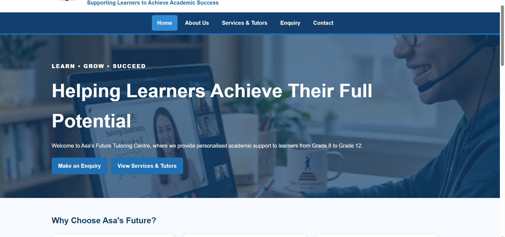
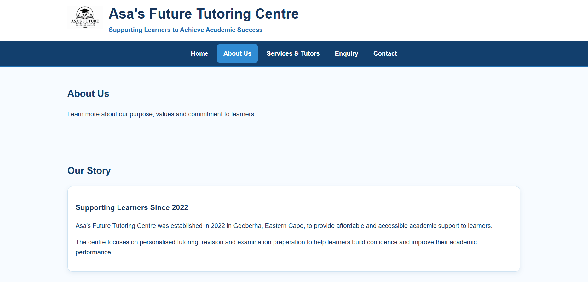
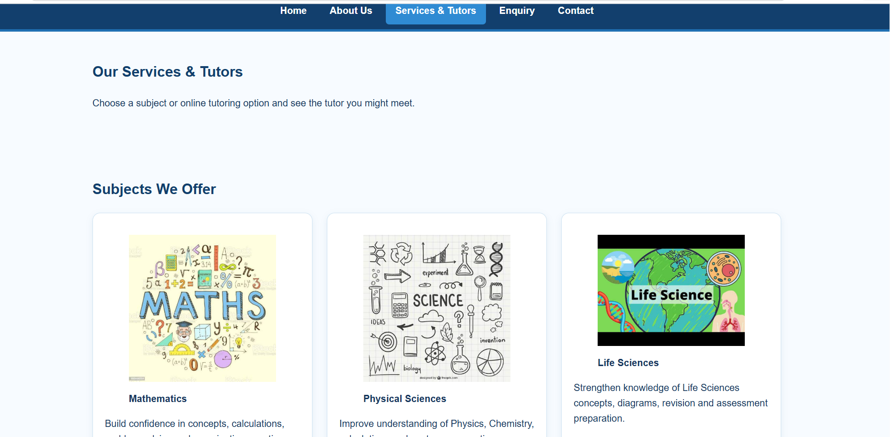
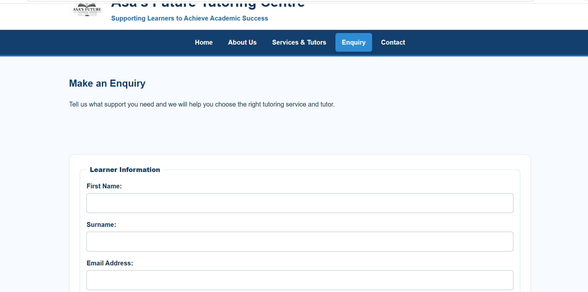
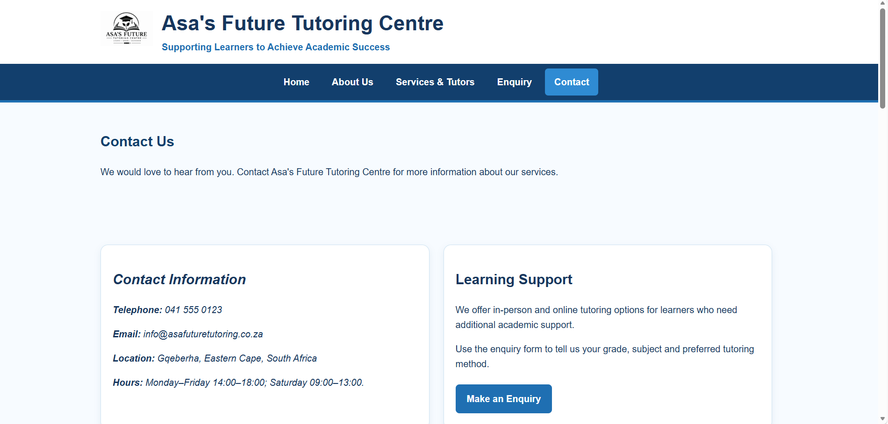

# ASA'S FUTURE TUTORING CENTRE

**Supporting Learners to Achieve Academic Success**

**LEARN • GROW • SUCCEED**

---

# 1. PROJECT OVERVIEW

Asa's Future Tutoring Centre is a fictional tutoring centre website developed as part of a web-development project.

The website was developed in three main parts:

* **Part 1 – HTML Website Development**
* **Part 2 – CSS Styling and Website Enhancement**
* **Part 3 – JavaScript, Interactivity and Search Engine Visibility**

The purpose of the website is to provide learners and parents with information about the tutoring centre, academic subjects, tutoring services, online tutoring, enquiries and contact information.

The website demonstrates the practical use of HTML5, CSS3, website navigation, images, forms, responsive design, accessibility, JavaScript, form validation, search engine optimisation (SEO), Git, GitHub and GitHub Pages.

---

# PART 1 – HTML WEBSITE DEVELOPMENT

## 2. Part 1 Overview

Part 1 focused on creating the basic structure and content of the website using HTML5.

The website was divided into multiple pages so that users can navigate between different sections of information.

The main HTML requirements included:

* Creating a homepage.
* Creating multiple website pages.
* Creating navigation between pages.
* Adding headings and paragraphs.
* Adding images.
* Adding lists.
* Adding links.
* Creating forms.
* Adding labels to form controls.
* Organising content using semantic HTML elements.
* Creating a logical website structure.

---

## 3. Website Pages

The website contains the following pages:

| Page     | File                  | Purpose                                     |
| -------- | --------------------- | ------------------------------------------- |
| Home     | `index.html`          | Introduces the tutoring centre              |
| About Us | `pages/about.html`    | Provides information about the organisation |
| Services | `pages/services.html` | Displays tutoring services and subjects     |
| Enquiry  | `pages/enquiry.html`  | Allows users to submit an enquiry           |
| Contact  | `pages/contact.html`  | Provides contact and location information   |

The homepage is stored in the root directory, while the remaining pages are stored inside the `pages` directory.

---

## 4. Website Content

The website provides information about Asa's Future Tutoring Centre.

### Organisation Information

* Organisation name.
* Year established.
* Location.
* Purpose.
* Mission.
* Vision.
* Values.
* Contact information.

The organisation was established in 2022 in Gqeberha, Eastern Cape, South Africa.

The purpose of the organisation is to provide affordable and accessible academic support to learners.

---

## 5. Home Page

The homepage is stored as:

```text
index.html
```

The homepage provides an introduction to Asa's Future Tutoring Centre.

The homepage includes:

* Organisation logo.
* Organisation name.
* Tagline.
* Slogan.
* Introduction to the tutoring centre.
* Navigation menu.
* Links to the other website pages.
* Relevant images.
* Call-to-action information.

The homepage is located in the root directory because GitHub Pages uses `index.html` as the default page when the website root is opened.

---

## 6. About Us Page

The About Us page is stored as:

```text
pages/about.html
```

The page provides information about the organisation.

Content includes:

* Background information.
* Establishment in 2022.
* Location in Gqeberha.
* Purpose of the tutoring centre.
* Mission.
* Vision.
* Values.
* Supporting information about learners.

The page also includes relevant images.

---

## 7. Services Page

The Services page is stored as:

```text
pages/services.html
```

The Services page provides information about the academic support offered.

### Subjects

The website includes the following subjects:

* Mathematics
* Physical Sciences
* Life Sciences
* English
* Accounting
* Business Studies
* CAT

### Tutoring Services

The services include:

* Subject tutoring.
* Revision.
* Examination preparation.
* Personalised academic support.
* Online tutoring.

---

## 8. Enquiry Page

The Enquiry page is stored as:

```text
pages/enquiry.html
```

The enquiry page provides a form that allows learners or parents to submit an enquiry.

The form includes appropriate controls for collecting information from the user.

Examples of form controls include:

* Full name.
* Email address.
* Telephone number.
* Subject selection.
* Message or enquiry.
* Submit button.

Form labels are included to clearly identify the information that users are expected to enter.

Example:

```html
<label for="name">Full Name:</label>
<input type="text" id="name" name="name">
```

---

## 9. Contact Page

The Contact page is stored as:

```text
pages/contact.html
```

The Contact page provides ways for learners and parents to contact the tutoring centre.

The page includes:

* Telephone information.
* Social-media information.
* Facebook.
* Instagram.
* WhatsApp Business.
* Location information.
* Map.
* Contact form or contact information.

---

## 10. HTML Navigation

Navigation links were created so users can move between all website pages.

From the homepage, links to pages inside the `pages` folder use:

```html
<a href="pages/about.html">About Us</a>
<a href="pages/services.html">Services</a>
<a href="pages/enquiry.html">Enquiry</a>
<a href="pages/contact.html">Contact</a>
```

From a page inside the `pages` folder, the link back to the homepage uses:

```html
<a href="../index.html">Home</a>
```

The `../` moves from the `pages` folder back to the root directory.

---

## 11. HTML Images

Images are stored inside the `assets` folder.

Examples include:

```text
assets/
├── asa-future-tutoring-logo.png
├── mathematics.jpg
├── life-science.jpg
└── online-tutoring.jpg
```

From the homepage, an image is referenced using:

```html

```

From a page inside the `pages` folder:

```html

```

Alternative text is included with images to improve accessibility.

---

## 12. HTML Forms and Labels

Forms were included to allow users to provide information to the tutoring centre.

Form labels clearly identify the purpose of each input field.

Example:

```html
<label for="email">Email Address:</label>
<input type="email" id="email" name="email">
```

The label's `for` attribute matches the input's `id`.

This improves usability and accessibility.

---

## 13. Semantic HTML

Semantic HTML elements are used to organise the website content.

Examples include:

```html
<header>
<nav>
<main>
<section>
<article>
<footer>
```

These elements provide a logical structure and make the content easier to understand.

---

# PART 2 – CSS STYLING AND WEBSITE ENHANCEMENT

## 14. Part 2 Overview

Part 2 focused on improving the appearance, layout and usability of the website using CSS.

The CSS was used to create a consistent design across the website pages.

Part 2 included:

* External CSS.
* Page layout.
* Typography.
* Colours.
* Navigation styling.
* Images.
* Buttons.
* Forms.
* Cards and sections.
* Responsive design.
* Background images.
* Hover effects.
* Consistent spacing.
* Mobile-friendly layouts.

---

## 15. External CSS

The website uses an external stylesheet:

```text
css/style.css
```

The stylesheet is linked from the homepage using:

```html
<link rel="stylesheet" href="css/style.css">
```

Pages inside the `pages` folder use:

```html
<link rel="stylesheet" href="../css/style.css">
```

Using an external stylesheet allows the same design rules to be applied consistently across multiple pages.

---

## 16. Website Layout

CSS was used to control the layout of the website.

The layout includes:

* Header.
* Navigation.
* Main content.
* Sections.
* Images.
* Service cards.
* Forms.
* Footer.

The design aims to make information easy to find and understand.

---

## 17. Navigation Styling

CSS was used to style the navigation menu.

The navigation styling controls elements such as:

* Link appearance.
* Spacing.
* Alignment.
* Hover effects.
* Navigation layout.

The navigation remains consistent throughout the website.

---

## 18. Typography

CSS was used to control the appearance of text.

Styling includes:

* Font family.
* Font size.
* Font weight.
* Line height.
* Heading sizes.
* Paragraph spacing.
* Text alignment.

Different heading sizes are used to create a clear visual hierarchy.

---

## 19. Images and Background Images

CSS was used to control the presentation of images.

This includes:

* Image sizing.
* Image positioning.
* Image borders.
* Image spacing.
* Responsive image sizing.

A background image can also be used on the homepage to improve the visual appearance of the website.

The background image is controlled through the external stylesheet.

---

## 20. Service Cards

The Services page uses structured sections/cards to present tutoring services and academic subjects.

The cards help users quickly identify:

* Mathematics.
* Physical Sciences.
* Life Sciences.
* Online tutoring.

CSS controls the layout, spacing and appearance of these sections.

---

## 21. Forms Styling

CSS was used to improve the appearance and usability of the forms.

Form styling includes:

* Input fields.
* Text areas.
* Selection controls.
* Buttons.
* Labels.
* Spacing.
* Field widths.

The form layout is designed to remain usable on smaller screens.

---

## 22. Responsive Design

Responsive CSS was included so that the website can adapt to different screen sizes.

The website was designed to work on:

* Desktop computers.
* Laptops.
* Tablets.
* Mobile phones.

Responsive design helps prevent content from extending beyond the screen and improves usability on smaller devices.

CSS media queries can be used to change the layout for smaller screens.

Example:

```css
@media (max-width: 768px) {
    /* Mobile layout adjustments */
}
```

---

## 23. Accessibility

Accessibility principles were considered throughout the website.

Examples include:

* Descriptive image `alt` text.
* Clear form labels.
* Logical headings.
* Readable text.
* Clear navigation.
* Sufficient spacing.
* Usable form controls.

These features help make the website easier to use for a wider range of visitors.

---

# PART 3 – JAVASCRIPT, INTERACTIVITY AND SEARCH ENGINE VISIBILITY

## 24. Part 3 Overview

Part 3 added JavaScript behaviour and search-engine optimisation (SEO) to the HTML and CSS website built in Parts 1 and 2.

Part 3 included:

* Client-side form validation with messages shown beside each field.
* Live character and word counters.
* Preparation of an email from the submitted form (`mailto`).
* Live service search and optional voice search.
* A click-to-play YouTube example lesson.
* A South African date display and countdown to midnight.
* An accessible image lightbox.
* About page enhancements: animated counters and a searchable FAQ accordion.
* SEO: page titles, descriptions, canonical links, social-sharing tags, structured data, `robots.txt` and `sitemap.xml`.

All JavaScript is plain JavaScript (no libraries or frameworks) and is stored in one file:

```text
js/site.js
```

---

## 25. JavaScript File Structure

Every page loads the script at the end of the page using:

```html
<script src="js/site.js" defer></script>
```

Pages inside the `pages` folder use `../js/site.js`. The `defer` attribute lets the page load first, and the script then runs once the HTML is ready.

`js/site.js` is divided into numbered sections. Each section only runs on pages that contain the elements it needs.

| Section | Feature                                  | Page(s)                  |
| ------- | ---------------------------------------- | ------------------------ |
| 1       | Form validation and email preparation    | Enquiry, Contact         |
| 2       | Live message counts and word limit       | Enquiry, Contact         |
| 3       | Service search                           | Services                 |
| 4       | Optional voice search                    | Services                 |
| 5       | Click-to-play YouTube video              | Home                     |
| 6       | South African date and midnight countdown | Home                    |
| 7       | Accessible image lightbox                | Home, Services           |
| 8       | Counting numbers and scroll reveal       | About                    |
| 9       | FAQ search, expand all and accordion     | About                    |

---

## 26. Form Validation

Both forms (Enquiry and Contact) use the class `js-email-form`, so one script validates both.

### When errors appear

* A field is checked as soon as the visitor **leaves it** (or changes a dropdown).
* Once a field shows an error, it is **re-checked while typing**, and the message disappears as soon as the value is corrected.
* When the visitor presses **Submit**, every field is checked, the first invalid field receives focus, and nothing is sent until all fields are valid.
* Each error message appears **directly under its own field**. There is no long summary of errors at the bottom of the form.

### Validation rules

| Rule                         | Detail                                                                 |
| ---------------------------- | ---------------------------------------------------------------------- |
| Required fields              | Cannot be empty or contain only spaces (values are trimmed)            |
| Email address                | Must match a regular expression (`emailPattern`) such as `name@example.com` |
| Telephone number             | 7 to 20 characters: digits, spaces, `+`, `-`, `.` and brackets         |
| Name fields                  | At least 2 characters                                                  |
| Message                      | At least 10 characters, a maximum of 350 characters and 350 words      |
| Enquiry type, grade, subject, tutoring method | A real option must be chosen from each dropdown       |

The enquiry type dropdown includes: new learner enrolment, tutoring fees and payment, lesson timetable and availability, online tutoring information, question about a subject or lesson, learner progress or assessment support, parent/guardian consultation and other question.

### Accessibility of the error messages

* Each message is a `<span class="field-error" role="alert">`, so screen readers announce it.
* The invalid field is marked with `aria-invalid="true"`.
* The message is linked to its field using `aria-describedby`, and the link is removed again when the error is fixed.
* The red message styling is defined in `css/style.css` (`.field-error`).

### Sending the enquiry

After validation succeeds, the script builds an email containing every field the visitor entered, including the full message, and opens it using a `mailto:` link to `info@asafuturetutoring.co.za`.

> **Important:** because the website is hosted on GitHub Pages (static hosting), it cannot send email or store form submissions itself. The visitor's email application opens and the visitor must press **Send**. Sending automatically would require a form backend or form service.

---

## 27. Live Counters and Message Limit

The message box shows a live count while the visitor types, for example:

```text
0/350 characters · 0/350 words
```

The message has a `maxlength="350"` attribute, and the script also checks the word count. The counters update on every keystroke and the limit is enforced when the form is validated.

---

## 28. Service Search and Voice Search

### Service search

The Services page has a search box above the service cards. As the visitor types, the script compares the text with the content of each card and hides the cards that do not match. A status line announces how many services are shown, for example `2 services shown.`

### Voice search

A **voice search button** lets visitors say a subject or service instead of typing it. It uses the browser's built-in speech recognition (`SpeechRecognition` / `webkitSpeechRecognition`).

* The feature only works in browsers that support speech recognition.
* In unsupported browsers the button shows the message "Voice search is not supported in this browser. Please type your search instead." and the normal text search still works.
* The button is responsive and has an accessible label.

---

## 29. Click-to-Play YouTube Example Lesson

The homepage includes an example mathematics lesson from YouTube. It is clearly labelled as third-party educational content and **not** a recording of Asa's classes.

To keep the page fast, only a lightweight thumbnail and a **Play** button are loaded at first. The full YouTube player loads only after the visitor clicks Play. A direct YouTube link remains available as a fallback. The video area is responsive and resizes on smaller screens.

---

## 30. South African Date and Midnight Countdown

The homepage shows:

* Today's date, generated automatically using the `Africa/Johannesburg` time zone.
* A live countdown (hours : minutes : seconds) to midnight South African time, refreshed every second using `setInterval`.

The date updates on every visit, so it does not need to be edited by hand.

---

## 31. Accessible Image Lightbox

Images wrapped in a link with the `data-lightbox` attribute (tutor portraits and service images) open in a larger viewer instead of leaving the page.

* The viewer is built with the native `<dialog>` element and opened using `showModal()`.
* It can be closed with the Close button or the **Escape** key.
* It shows the image's caption and has the accessible label "Enlarged image viewer".
* If a browser does not support `<dialog>`, the image link opens the image normally.

---

## 32. About Page Enhancements

### Our Story

* An "at a glance" strip with counting numbers (years of support since 2022, tutors, grades and core subjects) that count up when scrolled into view, using `IntersectionObserver`.
* The final numbers are already in the HTML, so they display without JavaScript. The animation is skipped for visitors who prefer reduced motion.
* The "years" figure is calculated from the 2022 founding year so it stays correct as time passes.
* A three-step "How we help learners grow" path.

### Mission, Vision and Values

Displayed as three icon cards. Cards across the website lift slightly on hover (disabled on touch screens and for visitors who prefer reduced motion).

### FAQ accordion

* Built on native `<details>` and `<summary>` elements, so it works with the keyboard and even without JavaScript.
* JavaScript adds a live question search with an announced result count, **Expand all** and **Collapse all** buttons, smooth open and close animation, and a "no results" message.
* The extra controls stay hidden until JavaScript runs.

---

## 33. Search Engine Optimisation (SEO) and Google Visibility

SEO was added so that search engines such as Google can find, understand and list the website.

### On every page

| Feature                    | Purpose                                                                  |
| -------------------------- | ------------------------------------------------------------------------ |
| Descriptive `<title>`      | Unique title per page, including the location (Gqeberha)                 |
| `meta description`         | A short summary that search engines can show in results                  |
| `meta keywords`            | Subject and location keywords                                            |
| `meta robots`              | `index, follow` allows search engines to list the page                   |
| Canonical link             | Tells Google the preferred address of each page                          |
| Open Graph / Twitter tags  | Controls the title, description and logo shown when a link is shared     |
| Site icon                  | The logo is used as the website icon                                     |
| Image `alt` text           | Describes every image for accessibility and image search                 |
| One `<h1>` per page        | Gives each page a clear main heading                                     |

### Structured data

The homepage contains JSON-LD structured data (`schema.org` type `EducationalOrganization`) giving the organisation name, address locality (Gqeberha, Eastern Cape, ZA), logo, website address, email, telephone and the area served. This helps Google understand what the website is about.

### robots.txt

```text
User-agent: *
Allow: /

Sitemap: https://asamkelisiwe-madikane.github.io/asa-tutoring/sitemap.xml
```

* `User-agent: *` applies the rules to all search-engine crawlers.
* `Allow: /` lets them visit every page.
* `Sitemap:` shows them where the sitemap is.
* The file name must be lowercase (`robots.txt`) because GitHub Pages is case-sensitive.

### sitemap.xml

The sitemap lists all five pages with their full web addresses and a last-modified date:

```text
https://asamkelisiwe-madikane.github.io/asa-tutoring/
https://asamkelisiwe-madikane.github.io/asa-tutoring/pages/about.html
https://asamkelisiwe-madikane.github.io/asa-tutoring/pages/services.html
https://asamkelisiwe-madikane.github.io/asa-tutoring/pages/enquiry.html
https://asamkelisiwe-madikane.github.io/asa-tutoring/pages/contact.html
```

If the website address changes (for example a custom domain), the addresses in `sitemap.xml`, `robots.txt`, the canonical links, the Open Graph tags and the structured data must all be updated.

### Registering the website with Google

1. Make sure the GitHub repository is public and GitHub Pages is publishing the `main` branch.
2. Open Google Search Console and add a **URL prefix** property for `https://asamkelisiwe-madikane.github.io/asa-tutoring/`.
3. Verify ownership using the **HTML tag** method (a `google-site-verification` meta tag in `index.html`).
4. Open **Sitemaps** and submit `sitemap.xml`.
5. Use **URL Inspection** on the homepage and choose **Request indexing**.

Google normally takes a few days to a few weeks to list a new website. Progress can be checked by searching `site:asamkelisiwe-madikane.github.io` on Google.

> **Note:** Google only reads `robots.txt` at the root of a domain, so on a GitHub project page the file mainly documents the intention. Submitting the sitemap in Google Search Console is what ensures the pages are discovered.

---

## 34. Part 3 Accessibility, Performance and Safety

* All JavaScript features work with the keyboard.
* Error messages, search results and the FAQ result count are announced to screen readers.
* Animations are skipped for visitors who ask their device for reduced motion.
* The FAQ, counters and form still display without JavaScript (progressive enhancement).
* The YouTube player loads only on request, so the page loads faster.
* Form values are trimmed and checked before an email is prepared.
* No external JavaScript libraries are used.

---

## 35. Part 3 Testing Checklist

| Test                                                                 | Expected result                                                        |
| -------------------------------------------------------------------- | ---------------------------------------------------------------------- |
| Leave the First Name field empty and click into the next field       | "This field is required." appears under First Name                     |
| Type `abc` into the Email field and leave it                         | An email format message appears under the field                        |
| Correct the email address                                            | The message disappears while typing                                    |
| Press Submit on an empty form                                        | Every field shows its own message and the first invalid field is focused |
| Type more than 350 characters or 350 words in the message            | The limit message appears and the form is not sent                     |
| Fill in the form correctly and press Submit                          | The email application opens with all entered details                   |
| Type "math" in the service search                                    | Only matching service cards remain and the count is updated            |
| Use voice search in a supported browser                              | The spoken words are placed in the search box and the cards filter     |
| Click Play on the homepage video                                     | The YouTube player loads and plays                                     |
| Watch the homepage countdown                                         | It updates every second and shows the South African date               |
| Click a tutor or service image                                       | The enlarged image opens; Escape closes it                             |
| Scroll to the About page "at a glance" strip                         | The numbers count up (or show immediately with reduced motion)         |
| Search and expand the FAQ                                            | Matching questions remain, the count updates, Expand/Collapse all work |
| Open `/robots.txt` and `/sitemap.xml` on the live website            | Both files load                                                        |
| View the website on a phone-sized screen                             | The layout fits the screen and nothing scrolls sideways                |

---

# WEBSITE STRUCTURE

## 36. Final Folder Structure

The final project follows this structure:

```text
Asa-s_Future_Tutoring_Centre/
│
├── index.html
├── README.md
├── robots.txt
├── sitemap.xml
├── Part 3-Implementation-Notes.txt
│
├── pages/
│   ├── about.html
│   ├── services.html
│   ├── enquiry.html
│   └── contact.html
│
├── assets/
│   └── assets/
│       ├── asa-future-tutoring-logo.png
│       ├── mathematics.jpg
│       ├── life Science.jpg
│       ├── physical science.jpg
│       ├── online-tutoring.jpg
│       ├── thandi-mokoena.jpg
│       ├── sipho-dlamini.jpg
│       ├── leanne-du-toit.jpg
│       ├── naledi-phiri.jpg
│       ├── facebook.jpg
│       ├── instagram.jpg
│       └── whatsapp.jpg
│
├── css/
│   └── style.css
│
└── js/
    └── site.js
```

All folder names use lowercase naming (and `robots.txt` is also lowercase):

```text
pages
assets
css
js
```

This helps avoid path and case-sensitivity problems.

---

## 37. Site Hierarchy

The website follows this structure:

```text
                    ASA'S FUTURE TUTORING CENTRE
                              |
        ------------------------------------------------
        |          |          |          |             |
       HOME      ABOUT     SERVICES   ENQUIRY       CONTACT
        |          |          |          |             |
     index.html    |          |       Form fields   Contact details
                   |          |
              Organisation   Academic Subjects
              Information    |
              Mission        -------------------------
              Vision         |      |      |         |
              Values        Maths  Physical  Life    Online
                            Sciences Sciences Tutoring
```

---

# PROJECT MANAGEMENT

## 38. Git and GitHub

Git and GitHub were used during the development of the website.

### Git was used for:

* Tracking changes.
* Creating commits.
* Maintaining different versions of the project.
* Recording development progress.

### GitHub was used for:

* Hosting the repository.
* Storing the website files.
* Managing the source code.
* Publishing the website through GitHub Pages.

**Repository:** `Asa-s_Future_Tutoring_Centre`

**GitHub Account:** `Asamkelisiwe-Madikane`

---

## 39. Version Control

Commits were used to record important stages of development.

Examples of commits include:

* Created initial website structure.
* Added homepage.
* Added About Us page.
* Added Services page.
* Added Enquiry page.
* Added Contact page.
* Added images and assets.
* Added CSS stylesheet.
* Added responsive design.
* Added background image.
* Corrected navigation paths.
* Corrected image paths.
* Updated website content.
* Prepared website for GitHub Pages.

Using Git commits provides a record of the development process.

---

## 40. GitHub Pages

The website was prepared for deployment using GitHub Pages.

The homepage is located in the root directory:

```text
index.html
```

The remaining pages are located inside:

```text
pages/
```

The website is published at:

[Asa's Future Tutoring Centre – GitHub Pages](https://asamkelisiwe-madikane.github.io/asa-tutoring/)


The repository is intended to remain public so that the website can be accessed and assessed.

---

# WEBSITE FEATURES

## 41. Main Website Features

The completed website includes:

* Multi-page navigation.
* Organisation information.
* Academic subject information.
* Tutoring services.
* Online tutoring.
* Images.
* Logo.
* Forms.
* Form labels.
* Contact information.
* Social-media links.
* Map/location information.
* External CSS.
* Responsive design.
* Background imagery.
* Consistent page layout.
* Accessibility features.
* JavaScript form validation with messages beside each field.
* Live character and word counters.
* Live service search and optional voice search.
* Click-to-play YouTube example lesson.
* South African date and midnight countdown.
* Accessible image lightbox.
* Searchable FAQ accordion and animated About page counters.
* Search engine optimisation: metadata, structured data, `robots.txt` and `sitemap.xml`.

---

## 42. Website Design Principles

The website was designed using the following principles.

### Consistency

The pages use a consistent navigation structure and visual design.

### Simplicity

Information is presented in a straightforward way.

### Accessibility

Images, forms, headings and navigation are designed to be accessible and understandable.

### Visual Hierarchy

Headings, sections and images help users identify important information.

### Usability

Navigation and forms are arranged so users can easily find information and provide enquiries.

### Responsiveness

The layout adapts to different screen sizes.

---

## 43. Project Challenges and Solutions

Several common website-development challenges were addressed during the project.

| Challenge                       | Solution                                           |
| ------------------------------- | -------------------------------------------------- |
| Homepage not loading            | Place `index.html` in the repository root          |
| Page links not working          | Use correct relative paths                         |
| Images not displaying           | Check the `assets/` folder and filenames           |
| CSS not loading                 | Check the stylesheet path                          |
| Different folder capitalisation | Use lowercase folder names consistently            |
| GitHub Pages 404 error          | Check repository structure and Pages configuration |
| Mobile layout problems          | Use responsive CSS                                 |
| Incorrect image paths           | Use the correct path based on page location        |
| Forms difficult to use          | Add clear labels and appropriate controls          |

---

# TECHNOLOGIES

## 44. Technologies Used

| Technology   | Purpose                         |
| ------------ | ------------------------------- |
| HTML5        | Website structure and content   |
| CSS          | Website styling and layout      |
| JavaScript   | Form validation, search, countdown, lightbox and FAQ |
| JSON-LD      | Structured data for search engines |
| Google Search Console | Submitting the sitemap and requesting indexing |
| Git          | Version control                 |
| GitHub       | Repository hosting              |
| GitHub Pages | Website deployment              |
| Web Browser  | Website development and viewing |

---

# PROJECT OUTCOME

## 45. Project Outcome

The completed project provides a structured website for the fictional Asa's Future Tutoring Centre.

The website demonstrates the practical application of:

* HTML5.
* CSS3.
* JavaScript.
* Website structure.
* Navigation.
* Images.
* Forms.
* Form labels.
* Accessibility.
* Responsive design.
* Background images.
* Website styling.
* JavaScript interactivity and form validation.
* Search engine optimisation (SEO).
* Version control.
* GitHub.
* GitHub Pages.

The website provides learners and parents with information about the organisation, academic subjects, tutoring services, online tutoring, enquiries and contact options.

# ✅ CHANGELOG
## Changelog (Updates Made)
- ✅ **Part 3 documentation:** added the Part 3 section (sections 24–35) covering JavaScript, form validation, search, countdown, lightbox, About page features, SEO and a testing checklist; updated the overview, folder structure, features, technologies and outcome.
- ✅ **Form validation:** error messages now appear directly under each field as soon as it is left (and update while typing) instead of in one long list at the bottom of the form.
- ✅ **Google visibility:** added `sitemap.xml`, renamed `Robots.txt` to lowercase `robots.txt`, and added canonical links, Open Graph and Twitter tags, a site icon and JSON-LD structured data.
- ✅ Added additional documentation details from **Part 1** into this ReadMe.
- ✅ Improved the use of **semantic HTML elements** documentation by explicitly outlining semantic structure practices in the Part 1 section.
- ✅ Enhanced clarity of **Part 1 feature explanations**, while keeping the rest of the ReadMe unchanged.
- ✅ Added a clearer **changelog heading** describing the updates made.
---
# Screenshots of how every page looks:





---

# REFERENCES

## 46. References

The following resources were consulted for general web-development information and technical guidance.

### HTML

Mozilla Developer Network (MDN). 2026. *HTML: HyperText Markup Language*. Available at:

[MDN HTML Documentation](https://developer.mozilla.org/en-US/docs/Web/HTML)

Accessed: 15 September 2026.

### CSS

Mozilla Developer Network (MDN). 2026. *CSS: Cascading Style Sheets*. Available at:

[MDN CSS Documentation](https://developer.mozilla.org/en-US/docs/Web/CSS)

Accessed: 15 September 2026.

### Web Accessibility

World Wide Web Consortium (W3C). 2026. *Web Accessibility Initiative*. Available at:

[W3C Web Accessibility Initiative](https://www.w3.org/WAI)

Accessed: 15 September 2026.

### GitHub

GitHub. 2026. *GitHub Documentation*. Available at:

[GitHub Documentation](https://github.com/Asamkelisiwe-Madikane/asa-tutoring)

Accessed: 15 September 2026.

### JavaScript

Mozilla Developer Network (MDN). 2026. *JavaScript*. Available at:

[MDN JavaScript Documentation](https://developer.mozilla.org/en-US/docs/Web/JavaScript)

### Search Engine Optimisation

Google. 2026. *Google Search Central*. Available at:

[Google Search Central](https://developers.google.com/search)

Schema.org. 2026. *Schema.org*. Available at:

[Schema.org](https://schema.org)

Sitemaps.org. 2026. *Sitemaps XML format*. Available at:

[Sitemaps protocol](https://www.sitemaps.org/protocol.html)

### HTML Validation

World Wide Web Consortium (W3C). 2026. *Markup Validation Service*. Available at:

[W3C Markup Validation Service](https://validator.w3.org)

Accessed: 15 September 2026.

### CSS Validation

World Wide Web Consortium (W3C). 2026. *CSS Validation Service*. Available at:

[W3C CSS Validation Service](https://jigsaw.w3.org/css-validator)

Accessed: 15 September 2026.

---

# AUTHOR INFORMATION

## 47. Author

**Student:** Asamkelisiwe Madikane

**Student Number:** ST10519703

**Project:** Asa's Future Tutoring Centre

**Year:** 2026

**Slogan:** LEARN • GROW • SUCCEED

**Tagline:** Supporting Learners to Achieve Academic Success
